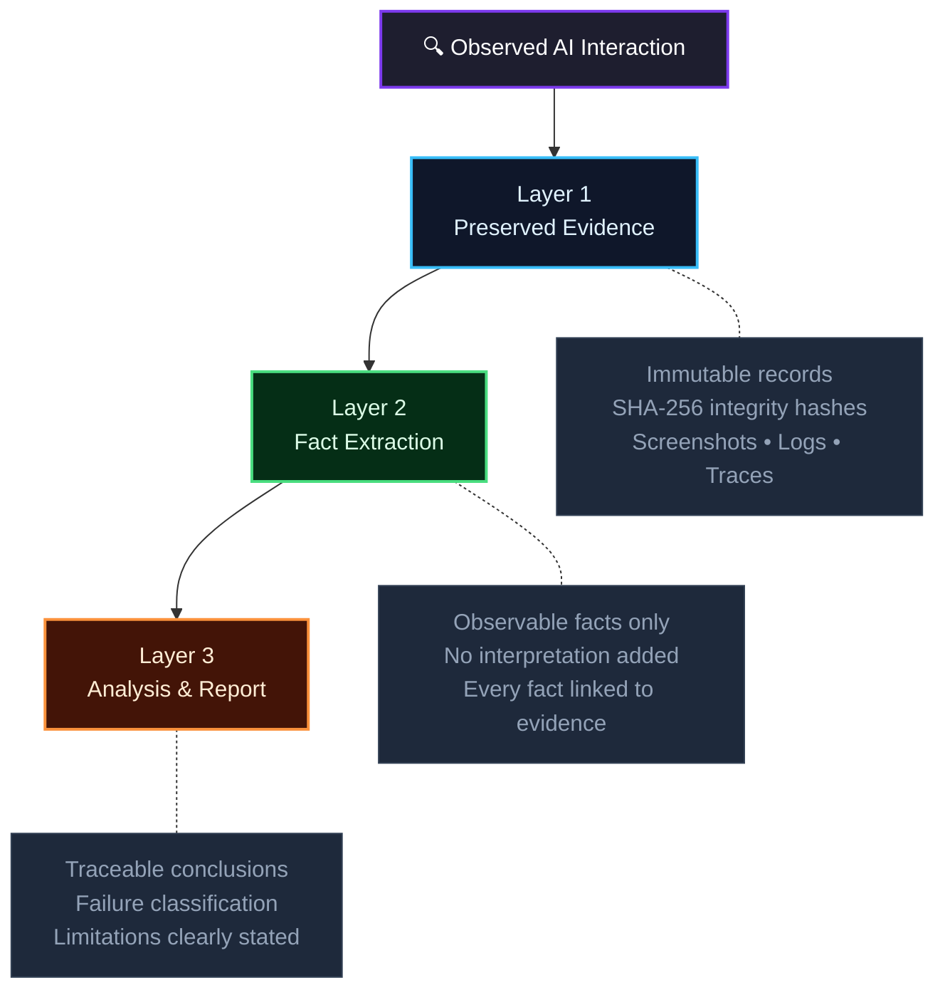

# CHRONOS

**An evidence-led methodology for documenting and analysing AI-system behaviour**

**Original Evidence Owner: Sirajudeen Seethapathy | Project CHRONOS — TamilOps**

## CHRONOS in 60 seconds

CHRONOS is an evidence-led approach to evaluating observed AI-system behaviour. It separates what happened from what can be established as fact and what the evaluator concludes. Each case is documented through a traceable evidence record, structured fact extraction, analysis and a classified report.

Its central control is a **Three-Layer Evidence Model**:

1. **Layer 1 — Preserved evidence:** Original interaction records and supporting materials are retained as the source record. Evidence files are logged and their integrity can be checked using SHA-256 hashes.
2. **Layer 2 — Fact extraction:** Observable details are extracted from the preserved evidence without adding interpretation. Each fact should point back to its source.
3. **Layer 3 — Analysis and reporting:** Findings, interpretations, classifications, impact assessments and limitations are stated separately and traced back to the extracted facts and source evidence.

This separation makes it easier for another reviewer to distinguish the original observation, the factual record and the evaluator's interpretation.

## Three-Layer Evidence Model — visual overview

## How a CHRONOS case moves through the method

`Observed interaction → Evidence capture and preservation → Evidence log and integrity check → Structured fact extraction → Analysis and failure classification → Evidence-linked report and limitations`

At each stage, the record should retain the connection to the preceding stage. A conclusion that cannot be traced to the documented facts and source evidence should not be presented as an established finding. Where evidence is incomplete or a point remains uncertain, that limitation should be made explicit.

## Why the method has professional value

CHRONOS is designed to make individual AI-behaviour evaluations more reviewable and auditable than an informal account or an unstructured collection of screenshots.

- **Evidence preservation:** Retaining source records provides reviewers with material to inspect beyond the evaluator's summary.
- **Integrity checking:** SHA-256 hashes can help detect whether a recorded evidence file has changed since the hash was generated. A hash does not, by itself, prove that the original capture was truthful or complete.
- **Separation of evidence and interpretation:** Layering reduces the risk of presenting an evaluator's explanation as if it were directly visible in the source record.
- **Traceability:** Linking reported claims to extracted facts and facts to evidence helps reviewers check how a finding was reached.
- **Consistent classification:** A defined failure taxonomy gives cases a common descriptive structure and can support comparison across documented cases.
- **Transparent limitations:** Recording test conditions, uncertainty and evidence boundaries discourages conclusions broader than the observed case supports.

Together, these controls provide a disciplined documentation and review structure. They do not guarantee that every evaluation is correct; the quality of a conclusion still depends on the test design, evidence quality, verification and scope of the evaluation.

## Professional positioning and potential use

CHRONOS is an independent research methodology and evidence archive developed by TamilOps. Its approach may be relevant to AI developers, product and quality teams, researchers, auditors, risk professionals and organisations that need documented analysis of specific AI-system behaviours.

The method can provide a structure for **scoped AI behaviour evaluation work**, such as documenting a defined interaction or workflow, preserving its evidence, extracting verifiable facts, analysing the observed behaviour and delivering a traceable report with limitations. Any external engagement would require an agreed scope, test conditions, access arrangements and deliverables.

The repository does **not** claim regulatory certification, formal accreditation, comprehensive model benchmarking or statistically representative failure rates. The four published specimens demonstrate documented cases; they do not establish how frequently the same behaviours occur across all users, prompts, systems or operating conditions.

## The four published specimens

| ID | Subject | System evaluated | Classification |
|---|---|---|---|
| [SPEC-001](specimens/SPEC-001/) | Tamil Siledai reasoning failure and unsupported generated claims | Claude | Reasoning failure |
| [SPEC-002](specimens/SPEC-002/) | Date cascade failure and delayed temporal correction | Claude Sonnet 4.6 | Temporal cascade failure |
| [SPEC-003](specimens/SPEC-003/) | Business-directory hallucination and source-data contamination | Gemini Pro | Hallucination |
| [SPEC-004](specimens/SPEC-004/) | Workflow duplication and transition-control failure | Claude Sonnet 5 Thinking | Workflow failure |

## Methodology documents

- [Evidence Handling Protocol](methodology/evidence-handling-protocol.md) — preservation, evidence logs, integrity checks and traceability.
- [Failure Classification Taxonomy](methodology/failure-classification-taxonomy.md) — the classification structure used by the published specimens.
- [Specimen Structure Standard](methodology/specimen-structure-standard.md) — archival reference describing the specimen documentation structure.

## Archive status

The CHRONOS specimen archive is **closed at SPEC-001 to SPEC-004**. These are the four specimens in this archive. No additional specimens are authorised or planned. This repository is presented for transparent review and independent criticism, not for new specimen submissions.

## Ownership and permissions

**Original Evidence Owner: Sirajudeen Seethapathy | Project CHRONOS — TamilOps**

Public access is provided for reading, scholarly review, independent criticism and citation. It does not grant permission to reproduce, redistribute, republish, adapt, or otherwise reuse original CHRONOS-authored material. Anyone wishing to use any part of SPEC-001 to SPEC-004 must contact the owner and obtain express prior written permission, except where a valid earlier licence grant or applicable law permits the specific use.

Some earlier published versions of CHRONOS material were distributed under CC BY-SA 4.0. Permissions already granted for those versions remain in force under that licence. Third-party materials remain subject to their respective rights.

Read the full [Rights, Ownership and Permissions notice](RIGHTS-AND-OWNERSHIP.md) before reuse.

## Citation

If you refer to this repository in research, use the metadata in [CITATION.cff](CITATION.cff). Citation and attribution do not, by themselves, constitute permission for uses that otherwise require permission.

---

**Project:** CHRONOS — TamilOps  
**Original Evidence Owner:** Sirajudeen Seethapathy